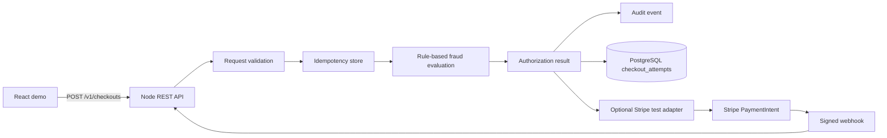

# Secure Payment Checkout Simulator

A production-style checkout simulator that makes the hard payment concerns explicit: token-only inputs, validation, idempotency, deterministic fraud decisions, audit events, PostgreSQL schema, Docker packaging, and a small React client.

It is a simulator, not a live payment processor. It never accepts raw card numbers and never claims to settle money. When `STRIPE_SECRET_KEY` and `STRIPE_WEBHOOK_SECRET` are set, the same API can use Stripe test mode for PaymentIntent creation and signed webhook reconciliation; live keys are intentionally not committed.

Live web client: https://secure-payment-checkout-simulator.vercel.app

## Architecture



## Structural overview

```text
src/
  domain/checkout.ts  request contract, token fingerprinting, fraud rules, result factory
  audit.ts            append-only audit event abstraction
  server.ts           HTTP boundary, error mapping, idempotency replay, Stripe webhook route
  persistence.ts      memory and PostgreSQL repository implementations
  providers/stripe.ts Stripe test-mode adapter and signature verification
sql/schema.sql        durable persistence contract
web/                  React demo client
 tests/               domain invariants
Dockerfile            immutable production image
docker-compose.yml    API + PostgreSQL local environment
```

## Workflow

1. The client sends an opaque payment token and a unique `Idempotency-Key`.
2. The API rejects malformed input before any downstream call.
3. A repeated key returns the original result and emits a replay audit event.
4. The fraud policy scores high amount, synthetic domains, and test-network traffic.
5. Low-risk requests become `authorized`; medium risk becomes `review`; high risk becomes `declined`.
6. Only a deterministic token fingerprint is persisted or returned.

## Why this shape

The domain layer is independent of HTTP and PostgreSQL so the important invariants can be tested without a running service. The repository boundary uses in-memory storage for deterministic tests and PostgreSQL with a unique idempotency constraint for Docker/production. Rule-based fraud is intentionally explainable and deterministic; a model can be added later behind the same decision contract, but it should not replace auditability or allow/deny policy review.

## Run locally

```bash
npm ci
npm test
npm run build
node dist/server.js
```

Run the full local stack:

```bash
docker compose up --build
```

The API listens on `http://localhost:8080`; health check is `GET /health`. The React demo can be run from `web/` with `npm install && npm run dev`.

To enable Stripe test mode, copy `.env.example` to `.env`, set `STRIPE_SECRET_KEY` and `STRIPE_WEBHOOK_SECRET`, and start the API with those variables loaded. The adapter sends the same idempotency key to Stripe. Configure your Stripe CLI or dashboard webhook endpoint to `POST /v1/webhooks/stripe`; signatures are rejected unless the timestamped HMAC matches and is within the replay tolerance window. Live keys are refused unless `ALLOW_LIVE_STRIPE=true` is explicitly set.

## Security boundaries

- Raw PAN/CVV are rejected at the API boundary.
- Request and response bodies are marked `no-store`.
- Idempotency keys are required and bounded in length.
- Audit events contain identifiers and decisions, never payment secrets.
- Production deployment must add authentication, TLS, provider webhook verification, rate limiting, encrypted storage, key rotation, and a real transactional idempotency table.
